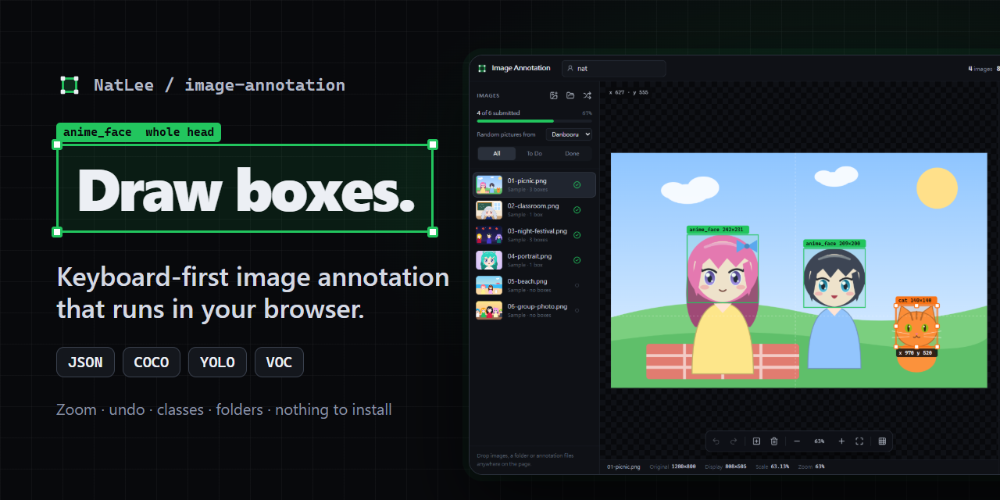
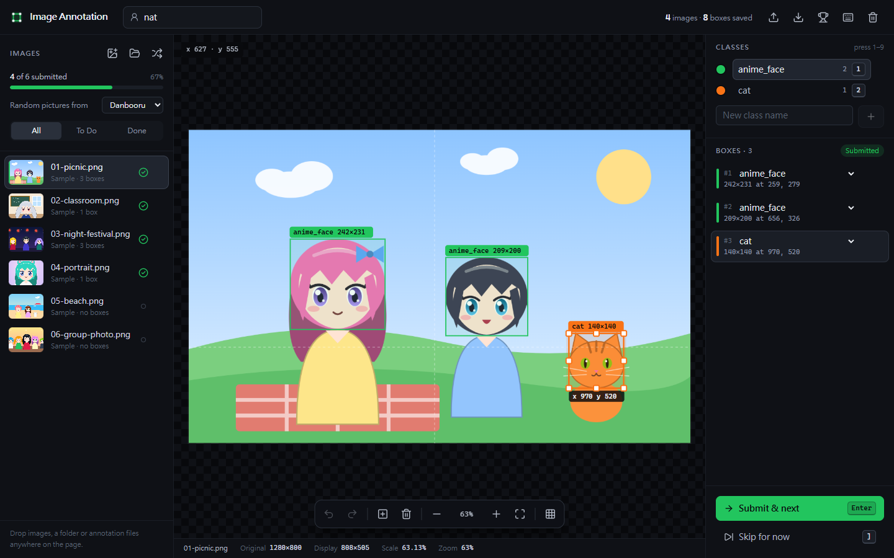
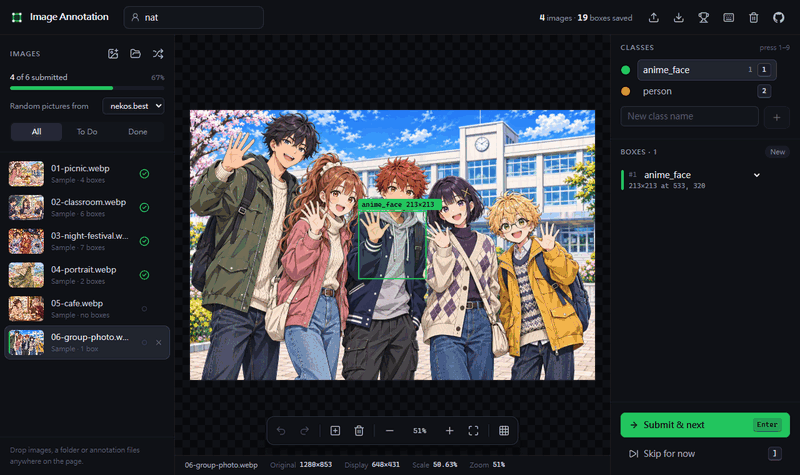
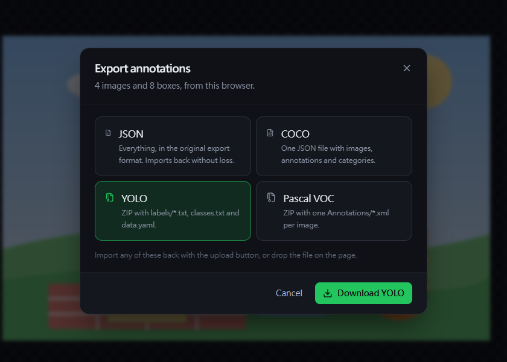
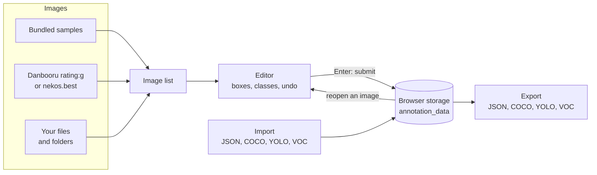

<p align="center">
  
</p>

# image-annotation

[](https://github.com/NatLee/image-annotation/actions/workflows/ci.yml)
[](https://natlee.github.io/image-annotation/)
[](LICENSE)


A keyboard-first bounding-box annotator that runs entirely in your browser. Start with random anime pictures from Danbooru, open a folder of your own images, or use the built-in illustrations offline; drag boxes around what matters, sort them into colour-coded classes, and export everything as COCO, YOLO, Pascal VOC or the app's own JSON. It began as a little crowd-sourcing tool for boxing anime faces, and it still does that, but it now handles any small labelling job. Nothing is uploaded: your work stays in the browser until you export it.

**[Open the app →](https://natlee.github.io/image-annotation/)**



## What it does

- **Draw** a box by dragging on the image. Move it, resize it from eight handles, nudge it with the arrow keys.
- **Classes** with colours. Press <kbd>1</kbd>–<kbd>9</kbd> to pick one; it relabels the selected box too.
- **Zoom** at the cursor with the mouse wheel, pan with <kbd>Space</kbd>+drag, press <kbd>0</kbd> to fit.
- **Undo and redo** every edit, separately for each image.
- **Work through a list**: thumbnails, status and a progress bar. Open files, a whole folder, or drop them anywhere on the page.
- **Import and export** JSON, COCO, YOLO and Pascal VOC.
- **Random anime pictures** from [Danbooru](https://danbooru.donmai.us) (general-audience `rating:g` posts only) or [nekos.best](https://nekos.best), press <kbd>R</kbd>. Each one is credited on the canvas: artist, a link to the post and the original source.
- From the original app: the leaderboard, the 10 × 10 grid on <kbd>D</kbd>, and a default box on every new image.



## Quick start

Use it online at **<https://natlee.github.io/image-annotation/>**. There is nothing to install.

To run it yourself you need Node.js 22.12 or newer:

```bash
git clone https://github.com/NatLee/image-annotation.git
cd image-annotation
npm install
npm run dev          # http://localhost:5173
```

`npm run build` writes a static site to `dist/` and `npm start` serves it. To host it under a sub-path, the way GitHub Pages does, pass the path when you build:

```bash
BASE_PATH=image-annotation npm run build   # assets load from /image-annotation/
```

## Annotating, step by step

1. Type your name in the top bar. It is stored with every image you submit and shows up on the leaderboard.
2. Pick images. The app opens a random Danbooru picture to start with; six original illustrations sit in the list too and take over when you are offline. Add your own with the buttons above the list, or drop files or folders on the page. The menu above the list switches random pictures between Danbooru and nekos.best.
3. Drag on the image to draw a box. Every new image starts with one default box (a square of 25% of the short side, in the middle), like the original app: adjust it or press <kbd>Del</kbd>.
4. Press <kbd>Enter</kbd> to submit. After an online picture you get another one; after your own files or the samples, the next image in the list that still needs work.
5. Export when you are finished. Submitted work survives a page reload; unsubmitted boxes are kept while the tab is open, and the browser warns you before you close it.

The house rule, kept from the original app: **框頭，整顆頭！** Box the head, the whole head.

## Keyboard shortcuts

Press <kbd>?</kbd> in the app to see the same list.

| Keys | Action |
| --- | --- |
| Drag on the image | Draw a box on an empty part of the image |
| Drag a box / handle | Move it, or resize it |
| <kbd>N</kbd> | Add a box (centred, or next to the last one) |
| <kbd>Del</kbd> / <kbd>Backspace</kbd> | Delete the selected box (or the last one) |
| <kbd>Tab</kbd> / <kbd>Shift</kbd>+<kbd>Tab</kbd> | Select the next / previous box |
| <kbd>Esc</kbd> | Deselect |
| <kbd>←</kbd> <kbd>↑</kbd> <kbd>→</kbd> <kbd>↓</kbd> | Move the selected box by 1 px |
| <kbd>Shift</kbd>+arrows | Move the selected box by 10 px |
| <kbd>1</kbd> … <kbd>9</kbd> | Pick a class (relabels the selected box) |
| <kbd>Ctrl</kbd>+<kbd>Z</kbd> | Undo |
| <kbd>Ctrl</kbd>+<kbd>Shift</kbd>+<kbd>Z</kbd> / <kbd>Ctrl</kbd>+<kbd>Y</kbd> | Redo |
| <kbd>Enter</kbd> | Submit and go to the next image |
| <kbd>]</kbd> / <kbd>PgDn</kbd> | Next image |
| <kbd>[</kbd> / <kbd>PgUp</kbd> | Previous image |
| <kbd>R</kbd> | Fetch a random online image |
| <kbd>O</kbd> | Open image files |
| Mouse wheel | Zoom at the cursor |
| <kbd>Space</kbd>+drag, or middle-drag | Pan |
| <kbd>=</kbd> / <kbd>+</kbd> | Zoom in |
| <kbd>-</kbd> | Zoom out |
| <kbd>0</kbd> / <kbd>F</kbd> | Fit the image to the screen |
| <kbd>D</kbd> | Show or hide the 10 × 10 grid |
| <kbd>?</kbd> | Show shortcuts and help |

On a Mac, <kbd>⌘</kbd> works wherever the table says <kbd>Ctrl</kbd>.

## Import and export



| Format | Export | Import |
| --- | --- | --- |
| JSON | `all_annotations_<date>.json`, the same format as the original app | That file, the app's storage data, or a plain array of records |
| COCO | `coco_annotations_<date>.json` with `images`, `annotations` and `categories` (ids from 1, in class order) | Any COCO detection file |
| YOLO | `yolo_labels_<date>.zip` with `labels/*.txt` (`class cx cy w h`, 0–1), `classes.txt`, `data.yaml` and `images.csv` (each label's image URL, size and credit) | `.txt` labels, loose, zipped or in a dataset folder, with `classes.txt`, `*.names` or `data.yaml`; segmentation polygons become boxes |
| Pascal VOC | `voc_annotations_<date>.zip` with one `Annotations/*.xml` per image | `.xml` files or a zip of them |

Online pictures keep their credit in every format: a `credit` object in JSON and in COCO's `images`, `<source>` and `<owner>` in VOC, and the extra columns of YOLO's `images.csv`.

Import with the upload button in the top bar, or drop the files on the page. Imported files are matched to the images in your list by path, then by the end of the path (so a LabelImg file that says `C:\data\cats\a.jpg` finds `cats/a.jpg`), then by a unique file name. YOLO stores positions as fractions of the image size, so it needs each image's size: from `images.csv` when the zip came from this app, otherwise from the images in your list (drop a dataset folder with `images/` and `labels/` together).

### The JSON format

The export is unchanged from the original app, so old files import as they are. Coordinates are in pixels of the original image.

```json
{
  "export_info": {
    "export_date": "2026-11-04T08:15:02.113Z",
    "total_images": 1,
    "total_annotations": 1,
    "data_range": {
      "first_annotation": "2026-11-04T08:01:44.871Z",
      "last_annotation": "2026-11-04T08:01:44.871Z"
    }
  },
  "annotation_records": [
    {
      "session_id": "session_1793779304871",
      "image_url": "samples/01-picnic.png",
      "original_size": { "width": 1280, "height": 800 },
      "display_size": { "width": 808, "height": 505 },
      "scale_factor": 0.63125,
      "annotator": "nat",
      "timestamp": "2026-11-04T08:01:44.871Z",
      "bounding_boxes": [
        { "id": "box_1793779290112_k3j9x0a1b", "x": 540, "y": 300, "width": 200, "height": 200, "label": "anime_face" }
      ]
    }
  ]
}
```

`image_url` names the image: a URL for online images, `samples/…` for the samples, and the path inside the folder you opened for your own files. `display_size` and `scale_factor` describe how large the image was on screen when fitted, as in the original app. Online pictures add a `credit` object, for example `{ "provider": "Danbooru", "artist": "…", "post_url": "https://danbooru.donmai.us/posts/…", "source_url": "…" }`; other records look exactly as before.

## How the data flows



The browser keeps a few things in `localStorage`: `annotation_data` (submitted images, the same key the original app used), `userName`, `image-annotation:classes` and your choice of random source. Your own images are read straight from disk and never leave the browser.

The app goes online only for random pictures: once when it opens, when you press <kbd>R</kbd>, and after you submit an online picture. Danbooru answers 20 general-audience posts per request; the app keeps them in memory and shows them one by one, so most pictures cost no extra request. If Danbooru is unreachable or rate-limiting, you get a message saying so, and the built-in illustrations carry on.

## Development

| Command | What it does |
| --- | --- |
| `npm run dev` | Dev server with hot reload |
| `npm run build` | Type check, then build the static site into `dist/` |
| `npm start` | Serve the built site |
| `npm run lint` | ESLint |
| `npm test` | Unit tests (Vitest): geometry, undo, storage, every import/export format |
| `npm run test:e2e` | Browser tests (Playwright) on a build served under `/image-annotation/` |
| `npm run samples` | Redraw the sample illustrations and `docs/demo-annotations.json` |

The end-to-end tests need a browser: run `npx playwright install chromium` once, or use an installed Edge or Chrome with `PW_CHANNEL=msedge npm run test:e2e`. `scripts/screenshots.mjs` regenerates the images in `docs/images/` from a running build.

The logic lives in plain, tested functions under `src/lib/` (geometry, undo history, the workspace reducer, storage and the formats in `src/lib/formats/`). The React components in `src/components/` only display that state and send actions. One table in `src/shortcuts.ts` drives the key handling, the help dialog and a test that checks this README.

CI on GitHub Actions lints, tests and builds every pull request, runs the browser tests, and deploys `master` to GitHub Pages only after both pass.

## Credits

The six sample pictures are original illustrations drawn in code (`scripts/samples.mjs`); their boxes are in `docs/demo-annotations.json`. They are the only pictures in this repository and in the screenshots. Random pictures load straight from [Danbooru](https://danbooru.donmai.us) or [nekos.best](https://nekos.best) while you use the app, and each one is credited to its artist with links to the post and the original source.

## License

[MIT](LICENSE)
